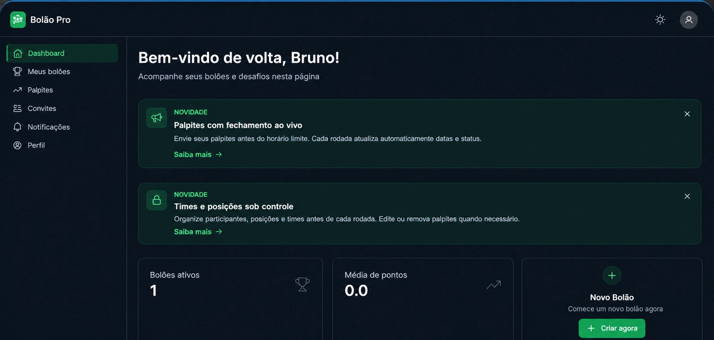

# Bolão Pro



> **In English:** Social betting-pool platform: create pools, make predictions on football matches, follow a live ranking and pay the entry fee via PIX (Brazilian instant payments). NestJS + Prisma + PostgreSQL back end, Next.js + React Query front end, PIX "copy and paste" codes generated in-house (EMV standard), with proof upload and admin approval. Live demo: https://bolaopro-eight.vercel.app

Plataforma social de bolões esportivos — crie bolões, faça palpites em partidas de futebol, processe pagamentos via PIX e acompanhe rankings em tempo real.

## Estrutura do Repositório

```
bolaopro/
├── server/          → Backend (NestJS + Prisma + PostgreSQL)
├── web/             → Frontend (Next.js + React Query + Tailwind)
├── docker-compose.yml
└── package.json     → Scripts do monorepo
```

## Stack

| Camada | Tecnologia |
|--------|-----------|
| Backend | NestJS 10, TypeScript, Prisma 5, PostgreSQL 16 |
| Frontend | Next.js 14, React 18, React Query, Tailwind CSS |
| Auth | JWT + Refresh Token + Google OAuth |
| Pagamentos | PIX (QR Code EMV) gerado pelo próprio sistema, com comprovante e aprovação do administrador |
| Deploy | Railway (backend) + Vercel (frontend) |
| Infra local | Docker (PostgreSQL + Redis) |

## Início Rápido

### Pré-requisitos
- Node.js 20+
- Docker

### 1. Instalar dependências
```bash
npm run install:all
```

### 2. Subir o banco de dados
```bash
docker-compose up -d
```

### 3. Configurar variáveis de ambiente

**Backend:**
```bash
cp server/.env.example server/.env
```

**Frontend:**
```bash
cp web/.env.example web/.env.local
```

### 4. Rodar as migrations
```bash
npm run db:migrate
```

### 5. (Opcional) Seed do banco
```bash
npm run db:seed
```

### 6. Subir o projeto completo
```bash
npm run dev
```

- Frontend: http://localhost:3000
- Backend: http://localhost:3001
- Swagger: http://localhost:3001/api/docs

## Scripts

```bash
npm run dev           # Sobe backend + frontend juntos
npm run dev:server    # Só o backend
npm run dev:web       # Só o frontend
npm run build:server  # Build do backend
npm run build:web     # Build do frontend
npm run db:migrate    # Migrations do Prisma
npm run db:seed       # Seed do banco
npm run db:studio     # Prisma Studio
npm run test          # Testes do backend
```

## Funcionalidades

- **Autenticação** — Login/registro com JWT, refresh token rotativo, Google OAuth, reset de senha
- **Bolões** — Criação com código de convite, sistema de cotas, taxa de entrada, distribuição de prêmios
- **Palpites** — Palpites de placar com trava automática 15min antes da partida
- **Rankings** — Classificação em tempo real (10pts placar exato, 0 caso contrário)
- **Pagamentos** — Geração de QR Code PIX, upload de comprovante, confirmação manual ou automática
- **Causas** — Apostas abertas (binário, múltipla escolha, numérico) em qualquer tema
- **Futebol** — Integração com football-data.org (placares ao vivo, classificações)
- **Notificações** — Sistema de notificações in-app
- **Admin** — Painel completo: times, campeonatos, partidas, financeiro, auditoria

## Módulos do Backend

```
server/src/modules/
├── auth/            → Login, registro, OAuth, tokens
├── users/           → Perfil, senha, stats
├── pools/           → Bolões, membros, prêmios
├── predictions/     → Palpites, batch save
├── rankings/        → Scoring engine, classificação
├── sports/          → Times, campeonatos, partidas
├── payments/        → PIX, comprovantes, admin financeiro
├── causas/          → Apostas abertas, votação, resolução
├── notifications/   → Notificações in-app
├── football-data/   → Integração football-data.org
└── audit/           → Log imutável de ações
```

## Decisões técnicas

- **PIX gerado pelo próprio sistema.** O código "copia e cola" e o QR Code são montados no padrão EMV do Banco Central, com o CRC16 calculado no back-end (`server/src/common/utils/pix.util.ts`). O pagamento é confirmado por comprovante e aprovação do administrador, sem depender de gateway nem de taxa por transação.
- **Pontuação e desempate como motores separados.** `scoring.engine.ts` e `tiebreaker.engine.ts` ficam isolados do resto do módulo de ranking, o que deixa a regra de pontos legível e fácil de mudar.
- **Sessão com token de acesso curto e refresh token salvo no banco**, com senhas em bcrypt. Um refresh token pode ser invalidado sem afetar os demais.
- **Log de auditoria** (`AuditLog`) com estado anterior e novo, usuário, IP e user agent em cada ação sensível, como pagamentos e resultados.
- **Jogos reais via football-data.org**, importados para o banco próprio. Tarefas agendadas fecham sozinhas o que venceu.
- **Monorepo com back e front separados** (`server/` e `web/`): o front fala com a API só por HTTP e pode ser trocado sem tocar no back.

## Limitações conhecidas e próximos passos

- Ainda **não há testes automatizados nem integração contínua**. É o próximo passo, começando pelos motores de pontuação e desempate, que são lógica pura.
- A confirmação do PIX é manual, feita pelo administrador. A integração com um provedor que avise o pagamento automaticamente fica para uma próxima versão.

## Deploy

| Serviço | URL |
|---------|-----|
| Backend | https://bolaopro-production-cd61.up.railway.app |
| Frontend | Vercel (via push na main) |
| API Docs | https://bolaopro-production-cd61.up.railway.app/api/docs |
